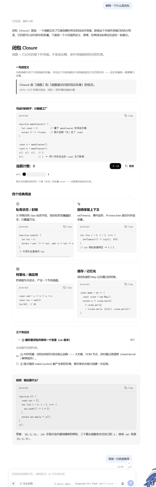
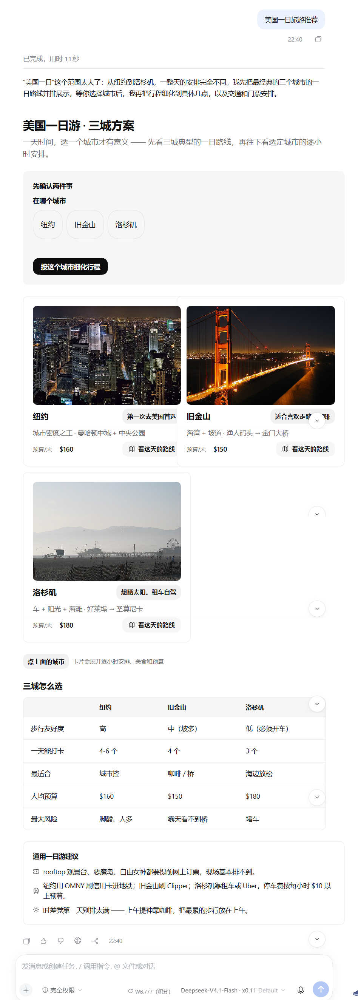
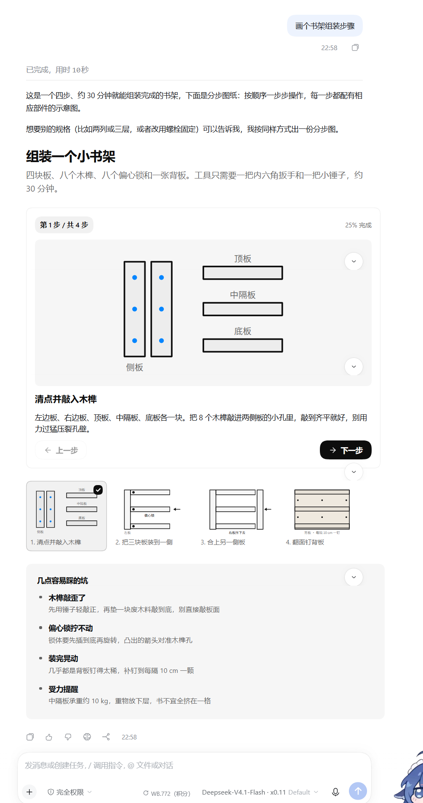

# dsh-intelligent-ui

[English](#english) · [中文](#中文)

ChatGPT-style **Intelligent UI** for [DeepSeek Harness](https://github.com/deepseek-ai): instead
of only prose, the model streams an [OpenUI Lang](https://github.com/thesysdev/openui) program
and the conversation renders it as an interactive card — a live calculator, a comparison table,
a chart, a step-by-step drawing, a photo carousel, a small map.

> Pure plugin: it patches nothing inside DSH and touches no file in `app.asar`, so it survives
> desktop updates and can be copied to any DSH installation.

**此为大肥鱼开发插件，如有问题请使用大肥鱼进行维修！！**

## 效果截图

| 概念解释：分块卡片 + 计数器 + 折叠区块 | 一日游推荐：图片卡片 + 对比表 + 选择器 |
| --- | --- |
|  |  |

| 分步图纸：SVG 绘图 + 步骤切换 + 步骤缩略图 |
| --- |
|  |

Every answer ends with one fenced ` ```ui ` block; the plugin hides that fence and draws the
card in its place. Nothing else in the transcript changes.

## 功能

- **55 组件**：布局 `Col` `Row` `Box` `Card` `Grid` `Carousel` `Divider`；文字 `Title` `Text`
  `Caption` `Label` `Badge` `List` `ListItem` `Markdown` `Quote` `Code` `Math` `Link`；数据
  `Table` `Chart`；控件 `Button` `Input` `Slider` `Checkbox` `RadioGroup` `Select`
  `SegmentedControl` `DatePicker` `TextArea` `Form` `Timer`；媒体 `SearchImage` `Image` `Icon`
  `Map` `MapMarker` `YouTube`；绘图 `Svg` `G` `Circle` `Ellipse` `Rect` `Line` `Path`
  `Polyline` `Polygon` `SvgText` `Flashcard` `Celebration` `HtmlView` `Popover`。
- **63 个 `@函数` + 5 个交互动作**：`@Each` `@Range` `@Filter` `@Sum` `@GroupBy` `@Format`
  `@FormatDate` `@Plural` `@Clamp` …；`@Set` `@Reset` `@ToAssistant` `@OpenUrl`
  `@CopyToClipboard`。页面可以自己算、自己改，不必再问模型。
- **按钮能真的发消息**：`Button("跑一次测试", @ToAssistant("跑一次测试"))` 点下去等于你把
  这句话打进输入框回车——进入当前会话，按正常排队逻辑送出去。`@OpenUrl` 则打开链接。
- **自成一个 bundle**：`lib/client.js` 是单文件（约 3.6 MB），OpenUI、zod、KaTeX、
  lucide-react、MapLibre 及其 worker、全部样式都已打进去。运行时**不需要 `node_modules`**，
  也**不会联网下载**任何东西（只有 `SearchImage` 会去 Wikipedia/Commons 取照片）。
- **不破坏普通回答**：只有 ` ```ui ` 代码块会变成卡片，其余内容仍是普通 Markdown；卡片渲染
  失败时会退回到可展开的源码，不会把内容吞掉。

## 环境要求

- DSH Desktop 或 `dsh web`（需要 web UI；终端界面没有卡片）。
- 内核版本需落在 peer 范围 `>=0.1.7-rc.1 <0.3.0-0`（已在 Desktop 0.2.1-rc.2 验证）。
- 客户端需要 `conversation.chat.turnTail` 槽（随 `dsh-client-ui-chat` 提供）。

## 安装

直接使用预编译包（推荐，不需要 Node 工具链）：

1. 下载 [最新 Release](https://github.com/Mi-w-co/dsh-intelligent-ui/releases/latest) 里的
   `dsh-intelligent-ui-0.2.1.zip`，解压出 `dsh-intelligent-ui/` 目录（放到哪里都行，但不要放进
   `app.asar`）。
2. 打开 DSH → **插件 → 添加插件**，指向该目录，装完后**重启 DSH**。
3. 随便问一个值得可视化的问题，末尾出现卡片即成功。

`package.json` 里的 `dsh.client` 会被 DSH 按 specifier 缓存到重启为止，所以改过清单后
一定要重启；只改 bundle 内容则可以热更新。

## 从源码构建

```bash
pnpm install
node tools/build-prompt.mjs   # src/lib/prompt-options.ts + 组件库 -> lib/prompt-text.js
node tools/build-client.mjs   # src/** -> lib/client.js（含 MapLibre worker）
node test/verify.mjs          # 11 项无头渲染检查，需要 react / react-dom
node tools/pack.mjs           # 打出发行包 dist/dsh-intelligent-ui-<version>.zip
```

`lib/client.js`、`lib/prompt-text.js` 和 `src/lib/components/map/worker-source.generated.ts`
都是生成物（已 gitignore）。改代码请改 `src/`，不要改生成物。

## 工作原理

| 半边 | 文件 | 作用 |
| --- | --- | --- |
| Host | `lib/index.js` | 用 `ctx.systemPrompt.section` 注册「OpenUI Lang 写作说明」，并用 `lib/prompt.js` 追加一段强制的输出契约，让模型知道要产出 ` ```ui ` 块。 |
| Client | `lib/client.js` | 在 `conversation.chat.turnTail` 列表槽注册一个条目，读取本轮助手文本，把每个 ` ```ui ` 围栏渲染成卡片，并把被卡片取代的源码块折叠掉。 |

`lib/prompt-text.js` 由官方 `generateSystemPrompt` 从同一套组件库生成，所以提示词不可能
宣告一个渲染器画不出的组件。卡片位置在轮尾，是因为整条助手消息的 keyed 槽
（`conversation.chat.node`）已被内置插件占满。

已知边界：卡片在整轮结束后才渲染；终端界面不支持；`SearchImage` 需要能访问
Wikipedia/Commons 的网络；`@Each` 的遍历变量在部分上下文里取值不稳定，复杂列表建议
先收集再用。

## License

[MIT](LICENSE)。内置的第三方库保留各自许可（OpenUI、KaTeX、MapLibre GL、lucide、zod）。

---

## English

**Intelligent UI** renders OpenUI Lang programs emitted inside ` ```ui ` fences as interactive
cards in the DSH chat: charts, tables, sliders, forms, photo cards, SVG drawings and maps.


- 55 components, 63 `@functions`, 5 actions.
- One self-contained `lib/client.js` (~3.6 MB): no runtime `node_modules`, no downloads. Only
  `SearchImage` fetches photos from Wikipedia/Commons.
- Pure plugin: nothing in `app.asar` is patched, so it survives app updates.

**Install:** download `dsh-intelligent-ui-<version>.zip` from Releases, unzip, then
DSH → Plugins → Add plugin → the `dsh-intelligent-ui/` directory, and restart DSH.
Requires a DSH build in `>=0.1.7-rc.1 <0.3.0-0` with a web UI.

**Build:** `pnpm install && node tools/build-prompt.mjs && node tools/build-client.mjs &&
node test/verify.mjs`.

